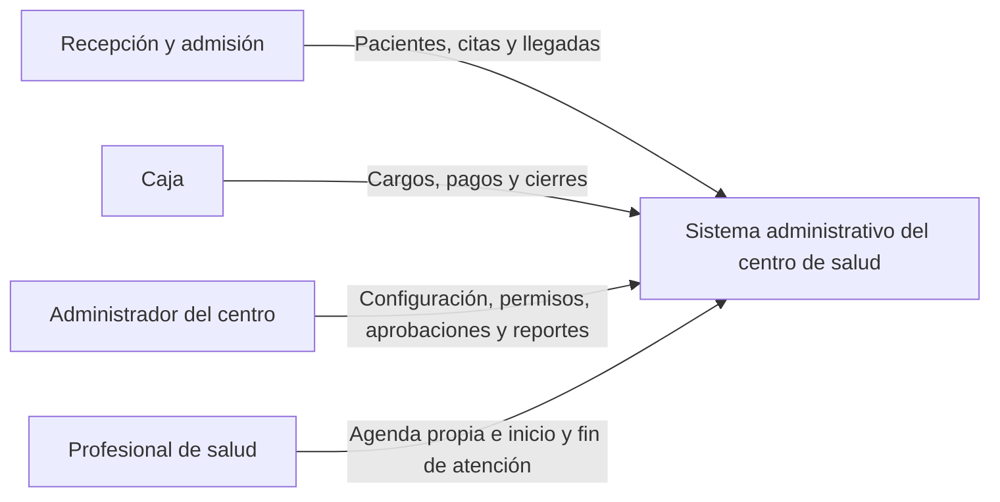
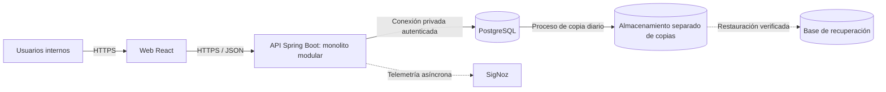
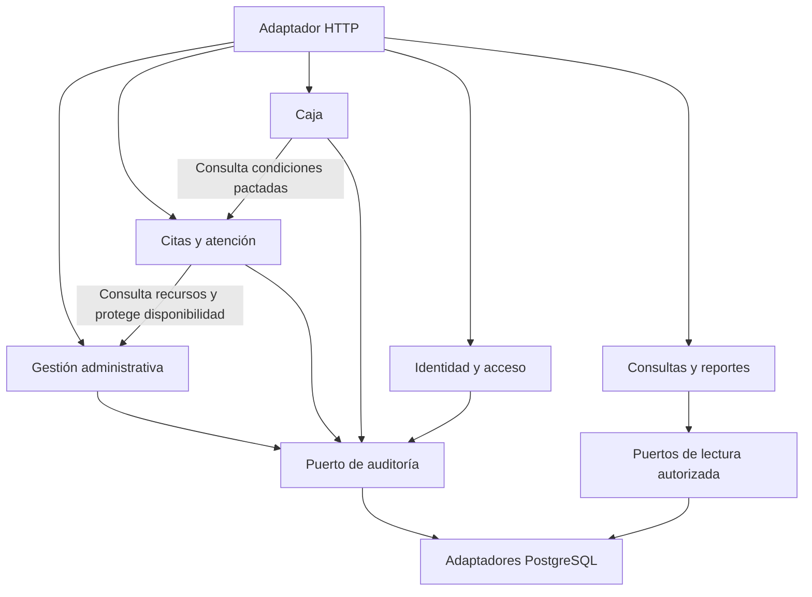
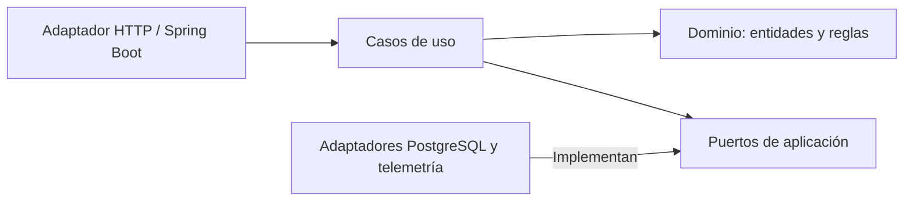

# ADD — Primera iteración del sistema administrativo del centro de salud

Versión 1.0 · 8 de octubre de 2026 · Estado: diseño de primera iteración consolidado; implementación y validación pendientes.

## 1. Propósito y entradas

Esta iteración aplica Attribute-Driven Design (ADD) para definir la estructura general del sistema, distribuir responsabilidades y establecer cómo colaboran sus partes. El resultado es una base de diseño para implementar; no constituye evidencia de que los atributos de calidad ya se cumplen.

Se utilizan el [contexto y problema](01_CONTEXTO_Y_PROBLEMA.md), los [requerimientos v1.1](02_REQUERIMIENTOS_DEL_SISTEMA.md), la [matriz de tendencias y requerimientos](03_MATRIZ_TENDENCIAS_REQUERIMIENTOS.md) y la [guía de la clase](04_GUIA_ADD_DEL_CURSO.md). La clase TEO_02_Atributos_Drivers_y_Metodos.pdf orienta los escenarios de seis campos, la selección de drivers, la matriz de elementos y la evaluación de la iteración. Los lineamientos PRA_Proyecto_curso_TAS_2026-II.pdf establecen los entregables de la presentación; los ejemplos de sistemas mostrados en clase no son restricciones de este proyecto.

El sistema cubre una sede y su operación administrativa: pacientes, recursos, programación, admisión, seguimiento administrativo de atención, caja, reportes y auditoría. No incluye historia clínica ni un portal de pacientes. Existen dos grupos de usuarios, con cuatro roles de autorización: personal administrativo (recepción/admisión, caja y administrador) y profesional de salud. Una persona puede reunir roles; esto no elimina las restricciones por registro ni la separación entre solicitante y aprobador.

## 2. Objetivo y límite de la iteración

Definir una arquitectura que permita coordinar la atención y el movimiento de dinero sin accesos indebidos, reservas incompatibles ni movimientos duplicados, manteniendo separación entre reglas de negocio, interfaz y tecnología.

Se refina el sistema completo hasta sus contenedores, módulos principales, responsabilidades e interfaces. Se resuelven los mecanismos estructurales de autorización, transacciones, auditoría y observabilidad. El detalle de tablas, contratos OpenAPI completos, pantallas y configuración de despliegue se refinará posteriormente. No es necesario terminar el desarrollo para cerrar esta iteración de diseño, pero sus decisiones deberán verificarse durante la implementación.

## 3. Drivers arquitectónicos

La prioridad indica influencia en esta iteración, no permiso para omitir un requisito obligatorio. Los drivers agrupan requisitos que provocan decisiones estructurales; no reemplazan el catálogo completo.

| Código | Driver y tipo | Fuentes | Prioridad | Influencia en el diseño |
|---|---|---|---|---|
| D-01 | Coordinar la operación administrativa y la atención. Funcionalidad principal. | RF-04 a RF-18; RN-04 a RN-12 | Alta | Separar datos maestros, programación y estados de atención, conservando una operación coherente. |
| D-02 | Controlar cargos, pagos, anulaciones y cierres. Funcionalidad principal. | RF-19 a RF-24; RF-27; RN-13 a RN-16 | Alta | Modelar movimientos y saldos, sesiones de caja y compensaciones sin borrar historia. |
| D-03 | Autorizar por acción y registro, con sesiones revocables. Seguridad. | RF-01 a RF-03; RN-01 a RN-03; RNF-01 y RNF-02 | Alta | Centralizar identidad y políticas, verificándolas en cada caso de uso. |
| D-04 | Conservar integridad ante concurrencia, reintentos y fallos. Confiabilidad. | RF-13, RF-14, RF-19 a RF-24; RN-07, RN-13 a RN-15; RNF-03 | Alta | Usar transacciones, restricciones de persistencia, exclusión entre operaciones incompatibles e idempotencia. |
| D-05 | Responder bajo la carga definida. Rendimiento. | RNF-04; RF-12, RF-25 y RF-27 | Alta | Acotar consultas, paginar e indexar según rutas de acceso; medir latencia con carga real de prueba. |
| D-06 | Recuperar la operación y los datos. Disponibilidad y recuperabilidad. | RNF-09 y RNF-10 | Alta | Persistencia externa al proceso, comprobaciones de disponibilidad y restauración verificable. |
| D-07 | Mantener y probar reglas sin depender de la interfaz. Modificabilidad y comprobabilidad. | RNF-06, RNF-07 y RNF-12 | Alta | Monolito modular, puertos y adaptadores, pruebas de dominio y de mutación. |
| D-08 | Permitir el uso accesible de los flujos principales. Usabilidad. | RNF-08 | Media | Componentes web accesibles, mensajes de error utilizables y pruebas automáticas y manuales. |
| D-09 | Rastrear operaciones y diagnosticar fallos. Auditabilidad y observabilidad. | RF-28; RN-17; RNF-05 | Alta | Separar auditoría transaccional de negocio y telemetría técnica correlacionada. |
| D-10 | Cumplir restricciones de arquitectura, nube y tendencias. Restricción de diseño. | Lineamientos del proyecto; matriz de tendencias; RNF-06 | Obligatoria | Arquitectura hexagonal, despliegue preparado para nube y evidencia de las seis tendencias en su función correspondiente. |

Spring Boot, PostgreSQL y el monolito modular son decisiones del proyecto, no tecnologías impuestas por el profesor. React y SigNoz forman parte de la selección de tendencias acordada.

## 4. Cuatro escenarios de atributos de calidad

Se sigue el formato de seis campos de la clase. Las medidas son criterios de aceptación pendientes de ejecución, no resultados observados.

### EC-01 — Acceso a una cita ajena

| Campo | Definición |
|---|---|
| Origen | Profesional de salud autenticado. |
| Estímulo | Cambia el identificador de una cita para consultar o modificar una asignada a otro profesional. |
| Artefacto | API, caso de uso y política de acceso a citas. |
| Entorno | Operación normal, con sesión vigente y datos de al menos dos profesionales. |
| Resultado | Se rechaza el acceso, sin devolver datos de la cita ajena ni efectuar cambios. La comprobación se realiza aunque la petición no provenga de la interfaz web. |
| Medida del resultado | Cero lecturas y modificaciones no autorizadas en la batería de casos negativos; los casos autorizados siguen funcionando. Se incluyen cuentas con varios roles y cuentas desactivadas. |

Fuentes: D-03, RF-02, RF-12, RF-17 y RNF-01. Tácticas: mínimo privilegio, validación de sesión y autorización sobre el recurso en el backend.

### EC-02 — Reservas simultáneas incompatibles

| Campo | Definición |
|---|---|
| Origen | Diez solicitudes concurrentes de recepción/admisión. |
| Estímulo | Intentan reservar citas incompatibles en un intervalo inicialmente libre del mismo profesional o consultorio; se prueba también la incompatibilidad por paciente. |
| Artefacto | Caso de uso de reserva y persistencia de citas. |
| Entorno | Sesiones válidas, recursos activos y horario disponible; las diez solicitudes llegan concurrentemente. |
| Resultado | Se confirma una única reserva; las demás reciben un conflicto de disponibilidad sin dejar registros parciales. |
| Medida del resultado | Exactamente una reserva confirmada por cada conjunto de diez solicitudes incompatibles y cero solapamientos persistidos. Intervalos adyacentes válidos pueden reservarse. |

Fuentes: D-04, RF-13, RN-07 y RNF-03. Tácticas: transacción y protección del intervalo en la base de datos. La consulta previa de disponibilidad no garantiza la reserva. Este escenario no sustituye las pruebas de pagos y cierres indicadas en la sección 10.

### EC-03 — Tiempo de respuesta en operación

| Campo | Definición |
|---|---|
| Origen | Veinte usuarios concurrentes con roles y sesiones válidos. |
| Estímulo | Ejecutan durante diez minutos una mezcla de 70 % lecturas y 30 % escrituras, con operaciones representativas de agenda, pacientes y caja. |
| Artefacto | API y PostgreSQL. |
| Entorno | Entorno de referencia de RNF-04: 4 vCPU y 8 GiB para API y base de datos, 10 000 pacientes y 50 000 citas; calentamiento previo y red local. Los recursos de SigNoz se contabilizan aparte. |
| Resultado | Se responden las solicitudes preservando autorización y consistencia. |
| Medida del resultado | Percentil 95 de respuesta de la API ≤ 2 segundos y menos de 1 % de errores inesperados. Los rechazos de negocio esperados se distinguen de fallos técnicos. Se registra mezcla exacta, configuración y resultados por operación. |

Fuentes: D-05 y RNF-04. Tácticas: índices, consultas acotadas, paginación y observación de operaciones lentas. Este escenario no mide por sí solo el tiempo de renderizado del navegador.

### EC-04 — Restauración después de pérdida de almacenamiento

| Campo | Definición |
|---|---|
| Origen | Fallo del almacenamiento persistente. |
| Estímulo | La base de datos deja de estar disponible y se requiere restaurar una copia. |
| Artefacto | PostgreSQL, copias de seguridad y procedimiento de recuperación. |
| Entorno | Entorno de recuperación separado, con copias diarias con conservación de siete copias y acceso a los artefactos necesarios. |
| Resultado | Se restaura la base y se habilita la aplicación después de verificar pacientes, reservas, movimientos y auditoría. Durante el fallo no se anuncian escrituras como exitosas. |
| Medida del resultado | RPO ≤ 24 horas, medido respecto al último dato recuperable, y RTO ≤ 60 minutos desde el inicio del incidente simulado hasta la disponibilidad verificada. Se conserva el registro de la restauración. |

Fuentes: D-06, RNF-09 y RNF-10. Tácticas: copias separadas del almacenamiento principal y procedimiento reproducible de restauración. Una copia diaria requiere vigilancia de su éxito; programarla no garantiza el RPO.

## 5. Contexto y límites



Los cuatro elementos externos son roles, no cuatro grupos independientes de usuarios. El paciente se registra como entidad del negocio y no interactúa directamente con esta aplicación. No se incorpora un operador técnico como actor de negocio. El mantenimiento del despliegue es una responsabilidad técnica, no una justificación para agregar permisos funcionales.

No hay integraciones comprometidas con bancos, aseguradoras, sistemas estatales o servicios clínicos. El registro de un pago no ejecuta una transferencia; el comprobante interno no equivale a un comprobante tributario.

## 6. Matriz de diseño según el formato de clase

Los ocho elementos siguientes refinan el sistema. E-02 a E-06 son módulos del mismo backend, no servicios desplegados independientemente. Las interfaces I-01 a I-08 se especifican en la sección 8.

| Elemento | Códigos de drivers arquitectónicos | Conceptos de diseño | Responsabilidades | Interfaces |
|---|---|---|---|---|
| E-01 · Aplicación web React | D-01, D-02, D-03, D-08, D-10 | Componentes reutilizables, formularios accesibles y navegación por permisos. | Presentar agendas, pacientes, atención, caja y administración; conservar el estado de interacción y comunicar conflictos. No decide la autorización ni calcula el saldo definitivo. | I-01: consume la API por HTTPS; I-02: inicio y cierre de sesión. |
| E-02 · Identidad y acceso | D-03, D-09 | Sesiones revocables, políticas por acción y recurso y mínimo privilegio. | Autenticar, gestionar cuentas y roles, revocar sesiones y resolver permisos. Impedir que una misma cuenta solicite y apruebe una anulación. | I-02: contratos de identidad; I-07: persistencia; I-06: auditoría; I-08: telemetría. |
| E-03 · Gestión administrativa | D-01, D-04, D-07 | Modelo de dominio, puertos de persistencia y control de versión. | Gestionar pacientes, profesionales, servicios, consultorios, disponibilidad y bloqueos; mantener identificadores únicos e informar impactos en citas. | I-03: contratos de datos maestros y disponibilidad; I-02, I-06, I-07 e I-08. |
| E-04 · Citas y atención | D-01, D-04, D-07 | Máquina de estados, transacciones y protección de intervalos. | Reservar, reprogramar y cancelar; registrar llegada, ausencia e inicio y fin de atención. Conservar duración y tarifa pactadas; evitar uso simultáneo incompatible. | I-04: operaciones de citas; consulta I-03; utiliza I-02, I-06, I-07 e I-08. |
| E-05 · Caja | D-02, D-03, D-04, D-07 | Movimientos compensatorios, aritmética decimal, idempotencia y serialización de cambios financieros. | Gestionar cargos, cobros parciales o totales, saldos, solicitudes y aprobación de anulación, apertura y cierre. Conservar movimientos originales y cierres inmutables. | I-05: contratos de caja; consulta de cita por I-04; utiliza I-02, I-06, I-07 e I-08. |
| E-06 · Consultas y auditoría | D-02, D-03, D-05, D-09 | Consultas específicas de lectura y registro de auditoría dentro de la transacción de negocio. | Calcular reportes según RN-16; consultar auditoría con permisos. Mantener separados los modelos de lectura y el registro de acciones. | I-06: consultas y escritura interna de auditoría; I-02, I-07 e I-08. |
| E-07 · Persistencia PostgreSQL | D-04, D-05, D-06, D-07 | Adaptadores, unidad de trabajo, restricciones e índices; copias y restauración. | Persistir datos y sesiones; hacer cumplir unicidad e integridad concurrente; confirmar o revertir una operación completa; respaldar información. | I-07: implementa repositorios y unidad de trabajo; conexión interna autenticada. |
| E-08 · Observabilidad SigNoz | D-05, D-09, D-10 | Instrumentación y exportación asíncrona de métricas, trazas y logs con OpenTelemetry. | Facilitar diagnóstico de latencia y fallos mediante correlación, sin almacenar cuerpos ni datos personales innecesarios. | I-08: recibe telemetría técnica; acceso técnico restringido. |

Reportes y auditoría comparten el agrupamiento E-06 para esta vista, pero son componentes separados: un reporte no escribe auditoría directamente en una tabla ni modifica movimientos. No se incorpora Event Sourcing: los movimientos financieros inmutables y la auditoría no implican reconstruir todo el sistema desde eventos.

## 7. Decisiones y justificación

| Decisión | Elección y motivo | Consecuencia o límite |
|---|---|---|
| DA-01 · Estructura de ejecución | Monolito modular: una API Spring Boot, módulos con contratos explícitos y PostgreSQL compartido. Facilita transacciones que abarcan cita, caja y auditoría, y reduce complejidad operativa. | Los módulos comparten despliegue y recursos. Se prohíben escrituras directas en tablas de otro módulo; extraer servicios exigiría revisar contratos y consistencia. |
| DA-02 · Organización interna | Arquitectura hexagonal: dominio, casos de uso, puertos y adaptadores. El dominio no importa React, Spring Boot ni el controlador de PostgreSQL. | Requiere límites verificables. No se crearán abstracciones duplicadas sin necesidad. |
| DA-03 · Acceso | Sesiones persistidas y revocables, con cookie segura de sesión; backend autoriza acción y recurso en cada solicitud. Contraseñas con hash adaptativo y sal; nunca reversibles. | Validar origen y protección CSRF en operaciones de escritura. La cookie será HttpOnly y Secure en despliegue HTTPS. Algoritmo, parámetros y configuración exacta se concretan antes de implementar identidad. |
| DA-04 · Consistencia | Una transacción por operación de negocio; reglas en dominio y protección concurrente en persistencia. Auditoría de una modificación confirmada se guarda en la misma transacción. | Fallar la auditoría obligatoria revierte la escritura. Los bloqueos se toman en orden consistente y duran solo lo necesario; no se realizan llamadas externas dentro de ellos. |
| DA-05 · Dinero e historial | Importes PEN con dos decimales, movimientos originales conservados y anulaciones mediante compensación vinculada. Cierre de caja persistido e inmutable. | No se usa punto flotante para dinero. Los reportes diferencian cargos, recaudación, saldo y fondo inicial. Corregir una operación no borra su historia. |
| DA-06 · Lecturas | Consultas específicas, filtros temporales, paginación e índices; se parte de la misma base transaccional. | No se introduce réplica, caché distribuida o almacén analítico sin evidencia de necesidad. Los reportes deben mantener las fórmulas de RN-16. |
| DA-07 · Diagnóstico | Auditoría de negocio en PostgreSQL; telemetría técnica en SigNoz mediante exportación desacoplada y acotada. | La caída de SigNoz no bloquea reservas ni cobros. Una interrupción puede perder telemetría, pero no la auditoría transaccional. |
| DA-08 · Ejecución en nube | API sin archivos de negocio ni sesiones exclusivas de su memoria; configuración por entorno, secretos externos al código, migraciones y comprobaciones de disponibilidad. | Proveedor, tamaños y mecanismo de almacenamiento de copias quedan pendientes. No se promete alta disponibilidad por tener un despliegue en nube. |
| DA-09 · Verificación | Pruebas de dominio, integración y concurrencia; mutación sobre reglas críticas, Axe-core y revisión de teclado. | Mutación y Axe-core complementan pruebas: no demuestran por sí solos consistencia ni accesibilidad completa. |

### 7.1 Operaciones que requieren protección concurrente

- **Reserva:** volver a comprobar recursos, disponibilidad y bloqueos dentro de la operación protegida. La persistencia debe impedir solapamientos de paciente, profesional y consultorio con intervalos semiabiertos `[inicio, fin)`. Reprogramar modifica la reserva de manera atómica: si falla el nuevo horario, se conserva el anterior.
- **Bloqueo de horario:** coordinarse con las reservas sobre el mismo recurso y período. No basta con proteger la tabla de citas: un bloqueo y una reserva no pueden confirmar decisiones contradictorias. Se identifican las citas afectadas y se impide iniciar las que mantengan conflicto sin resolver.
- **Inicio de atención:** proteger la ocupación efectiva del profesional y consultorio. Dos citas sin solapamiento programado pueden coincidir en la realidad si la primera atención se prolonga; la segunda no debe iniciarse hasta liberar ambos recursos.
- **Pago:** bloquear el agregado de cargo y la sesión de caja involucrada, releer el saldo e insertar el movimiento y su auditoría en una sola transacción. No aceptar que dos pagos concurrentes excedan el saldo.
- **Anulación:** volver a comprobar roles, cuenta solicitante, estado de solicitud y movimientos originales al aprobar. La aprobación y la compensación son indivisibles y no se repiten. La devolución debe registrarse en la sesión abierta que corresponda según RF-23; no altera una sesión cerrada.
- **Cierre:** pagos, compensaciones y cierre se coordinan sobre la misma sesión de caja. Si el cierre confirma primero, una escritura posterior se rechaza; si el pago confirma primero, queda incluido en el cierre. Dos aperturas concurrentes no generan dos cajas abiertas para el mismo cajero.

La siguiente iteración concretará restricciones y orden de bloqueo en el esquema de persistencia. Estas garantías son obligatorias; su mecanismo físico debe probarse con PostgreSQL, no únicamente con dobles de prueba en memoria.

## 8. Interfaces y contratos de colaboración

Los nombres siguientes son contratos de diseño; las rutas HTTP definitivas se publicarán en OpenAPI durante la implementación. Las llamadas entre módulos son internas al proceso, no peticiones HTTP entre microservicios.

| Interfaz | Consumidor y proveedor | Operaciones y datos esenciales | Reglas del contrato |
|---|---|---|---|
| I-01 · API de aplicación | React → adaptador HTTP Spring Boot | Solicitudes estructuradas JSON; identificadores, datos de formulario y versión del registro cuando corresponda. Respuestas con resultado, identificador y versión actual. | HTTPS, validación de entrada y autenticación salvo inicio/restablecimiento permitido. Errores con código estable, mensaje comprensible y correlación; sin trazas internas. |
| I-02 · Identidad y políticas | React y casos de uso → identidad | Iniciar/cerrar sesión, cambiar/restablecer contraseña, gestionar cuentas; `autorizar(actor, acción, recurso)`. | Obtener el actor desde la sesión, nunca desde un rol enviado por el navegador. Inactividad de 30 minutos y duración absoluta de 8 horas según RN-02; consultas automáticas no renuevan actividad. Desactivar o restablecer invalida sesiones. |
| I-03 · Datos maestros y disponibilidad | React y citas → gestión administrativa | Crear/actualizar paciente; consultar servicio, profesional y consultorio; consultar/proteger disponibilidad; registrar bloqueos. Datos: ID, versión, período, compatibilidades, duración y tarifa vigente. | Entidades activas y compatibles; controlar documento único y actualizaciones perdidas. La disponibilidad consultada es informativa hasta confirmar la transacción de reserva. |
| I-04 · Citas y atención | React y caja → citas | Reservar, reprogramar, cancelar, registrar llegada/ausencia, iniciar/finalizar; consultar resumen cobrable. Reserva recibe paciente, servicio, profesional, consultorio e inicio; calcula fin y copia tarifa/duración en servidor. | Aplicar RN-06 a RN-12 y autorización por recurso. Cambio de servicio requiere nueva cita. Caja recibe identidad y condiciones de cobro, no acceso irrestricto a datos del paciente. |
| I-05 · Caja | React → caja | Abrir sesión; generar cargo por cita; registrar pago; solicitar/aprobar anulación; consultar saldo y cerrar. Pago: cargo, sesión, importe, medio, referencia cuando aplique y clave de idempotencia. | Validar saldo y sesión abierta en transacción. Aprobador distinto del solicitante. Respuesta incluye movimiento y saldo confirmado; nunca se confía en un saldo calculado por React. |
| I-06 · Reportes y auditoría | React/casos de uso → componentes de E-06 | Consultar indicadores con filtros y fecha de corte; consultar auditoría; `registrarAcción(actor, acción, recurso, cambiosPermitidos, instante, correlación)`. | Reportes filtrados por alcance del rol. Auditoría de escritura participa en la unidad de trabajo del llamador; no es un endpoint libre para que el navegador fabrique registros. No guardar contraseñas, tokens ni cuerpos completos. |
| I-07 · Repositorios y unidad de trabajo | Casos de uso → puertos implementados por PostgreSQL | Cargar y guardar agregados, comprobar versión, proteger recursos, confirmar o revertir transacción. | Todos los cambios de una operación usan la misma transacción. Restricciones y conflictos se traducen a errores de negocio; no se exponen mensajes SQL. |
| I-08 · Telemetría | Adaptadores instrumentados → exportador → SigNoz | Duración, resultado técnico, nombre de operación y correlación de traza; métricas, logs y spans. | Exportación con tiempos y búfer acotados, sin datos personales en etiquetas ni cuerpos. No realizar exportación bloqueante dentro de una transacción de negocio. |

### 8.1 Respuestas y reintentos

- Solicitud sin sesión válida: `401`. Sesión válida sin permiso: `403`; para consultas fuera del alcance se puede devolver `404` de forma uniforme para no revelar la existencia del registro.
- Conflicto de disponibilidad, versión, estado o saldo: `409`. Entrada mal formada o inválida: `400` o `422`, según el contrato HTTP documentado.
- Operación confirmada: respuesta de éxito solo después de confirmar la transacción. Una base de datos no disponible produce un error controlado, nunca una confirmación ficticia.
- Para operaciones con efecto que pueden reenviarse —reserva, cargo, pago, aprobación y cierre— se utiliza una clave de idempotencia asociada a cuenta, operación y contenido. Repetir la misma solicitud devuelve su resultado confirmado; reutilizar la clave con otro contenido se rechaza. La comprobación de sesión y permisos precede también a la devolución de un resultado guardado.
- La clave y el resultado se conservan en persistencia con el efecto de negocio. Un tiempo de espera en el navegador no implica fracaso: se consulta o reintenta con la misma clave. La unicidad del negocio sigue protegiendo ante solicitudes con claves distintas.
- Las transiciones ya realizadas no duplican marcas de tiempo. Las actualizaciones de datos maestros incorporan una versión para advertir modificaciones concurrentes.

## 9. Vistas resultantes

### 9.1 Contenedores y despliegue lógico



La web y API se publican con HTTPS; base de datos, observabilidad y copias no se exponen a los usuarios finales. Se propone servir web y API bajo el mismo origen para simplificar sesión y configuración. El diagrama no fija proveedor ni número de máquinas. Las copias necesitan un destino independiente del disco que se está protegiendo. El entorno de referencia de rendimiento no incluye los recursos de SigNoz.

### 9.2 Módulos del backend



Todos los casos de uso verifican identidad y políticas y utilizan puertos de persistencia; esas conexiones transversales se omiten en esta vista para mantenerla legible. El componente de auditoría puede participar en la misma transacción que el módulo que modifica datos. Reportes puede leer proyecciones de varios módulos mediante contratos de consulta, sin modificar sus tablas.

### 9.3 Dependencias de código



Las flechas representan dependencias de código. El adaptador implementa el contrato definido hacia el interior; el dominio no conoce el adaptador. Esto permite ejecutar pruebas de reglas sin iniciar un servidor HTTP y reservar las pruebas de integración para garantías dependientes de la base real.

### 9.4 Secuencia de un pago

```mermaid
sequenceDiagram
    actor C as Cajero
    participant W as React
    participant A as Caso de uso de pago
    participant I as Identidad y políticas
    participant D as PostgreSQL
    C->>W: Confirma importe y medio
    W->>A: Registrar pago con clave de idempotencia
    A->>I: Validar sesión y permiso sobre la caja
    I-->>A: Autorizado
    A->>D: Iniciar transacción y comprobar idempotencia
    A->>D: Proteger caja y cargo; releer estado y saldo
    alt Caja abierta e importe válido
        A->>D: Guardar pago, auditoría y resultado idempotente
        A->>D: Confirmar transacción
        A-->>W: Movimiento y saldo confirmado
        W-->>C: Pago registrado
    else Conflicto o error
        A->>D: Revertir transacción
        A-->>W: Error controlado, sin pago parcial
        W-->>C: Explicar motivo y permitir corregir
    end
```

La secuencia muestra una solicitud nueva autorizada. Si la clave ya tiene resultado confirmado, se devuelve ese resultado después de validar acceso, sin crear un pago adicional. Si se pierde la respuesta después de confirmar, el reintento recupera el mismo resultado. Las solicitudes no autorizadas se rechazan antes de abrir la operación financiera.

## 10. Evaluación de la iteración

“Cubierto en diseño” significa que existe una decisión y un responsable identificable. No equivale a requisito probado ni a funcionalidad terminada.

| Driver | Cobertura de diseño | Evidencia que falta producir |
|---|---|---|
| D-01 | E-03/E-04; I-03/I-04; estados y disponibilidad protegida. | Flujos de pacientes, reserva, reprogramación, bloqueo, llegada y atención; comprobar todos los criterios RF-04 a RF-18. |
| D-02 | E-05/E-06; I-05; movimientos, saldos y cierre inmutable. | Cobros parciales, tarifa cero, anulación, separación de cuentas y reportes conciliados con datos de prueba. |
| D-03 | E-02; DA-03; EC-01. | Acceso directo por API, registros ajenos, combinaciones de roles, desactivación y revocación; protecciones de sesión y contraseña. |
| D-04 | DA-04/DA-05; sección 7.1; EC-02. | Diez reservas concurrentes, pagos que excederían saldo, aprobación duplicada, apertura duplicada y carrera pago/cierre; fallos inducidos con reversión completa. |
| D-05 | DA-06; EC-03; telemetría. | Medición de RNF-04 con configuración y conjunto de datos documentados. |
| D-06 | DA-08; EC-04; copias separadas. | Reinicio sin pérdida de operaciones confirmadas, caída de base sin falsos éxitos y restauración cronometrada. |
| D-07 | DA-01/DA-02/DA-09; puertos y dependencias. | Pruebas de dominio independientes del framework, ejecución reproducible y mutantes relevantes detectados o justificados. |
| D-08 | E-01; DA-09. | Axe-core y teclado en registro, reserva y pago, incluidos errores y diálogos; evidencias de corrección. |
| D-09 | I-06 e I-08; separación auditoría/telemetría. | Correlación de una reserva y pago; auditoría indivisible de la escritura; caída de SigNoz sin bloquear negocio; ausencia de datos sensibles. |
| D-10 | Hexagonal, despliegue lógico y seis tendencias con función definida. | Despliegue ejecutable y evidencias EV-01 a EV-06 de la matriz; documentación de uso real de Codex en código. |

### 10.1 Correspondencia con las seis tendencias

| Tendencia | Aplicación en esta iteración |
|---|---|
| Zero trust architecture · Techniques | D-03, E-02 y EC-01: verificar identidad y autorización por operación y registro, sin confiar en el navegador o la red. |
| Mutation testing · Techniques | D-07 y DA-09: evaluar pruebas de solapamiento, saldo, separación de aprobador y cierre. No es un módulo desplegado. |
| OpenAI Codex · Tools | Apoyo al desarrollo con revisión humana y evidencia de cambios de código. Este documento no acredita todavía su uso en la implementación. |
| Axe-core · Tools | E-01 y D-08: verificar automáticamente estados representativos de las pantallas y complementar con revisión manual. |
| SigNoz · Platforms | E-08 e I-08: diagnóstico técnico. No sustituye auditoría ni reportes de negocio. |
| React JS · Languages and Frameworks | E-01: interfaz interna para los cuatro roles. |

Se mantiene la distribución 2 + 2 + 1 + 1. La correspondencia entre “Technologies” de los lineamientos y “Techniques” del Radar se conserva como interpretación documentada en la matriz, no como una aprobación atribuida al profesor.

## 11. Asuntos abiertos y siguiente refinamiento

| Asunto | Resolución prevista | Momento límite |
|---|---|---|
| Esquema físico de reservas y bloqueos | Definir restricciones de intervalos, protección de disponibilidad y ocupación efectiva; fijar orden de bloqueos y probar carreras. | Antes de cerrar la implementación de citas. |
| Contratos completos | Detallar campos, validaciones, errores, paginación, versiones e idempotencia por operación en OpenAPI. Fijar conservación de claves acorde con los reintentos admitidos. | Antes de integrar cada flujo web/API. |
| Seguridad concreta | Elegir hash y parámetros, configuración de cookies/CSRF, limitación de intentos y mecanismo de restablecimiento sin incorporar servicios externos no previstos. | Antes de implementar autenticación y recuperación. |
| Políticas excepcionales | Precisar corrección de estados erróneos, llegadas fuera de fecha y atención a pacientes sin documento admitido. No añadir transiciones o excepciones silenciosas a RN-04 y RN-09/RN-10. | Antes de implementar una excepción; mientras tanto rigen los requisitos actuales. |
| Motivos financieros | Diferenciar corrección de registro y devolución efectiva; concretar datos de soporte, medios de pago y tratamiento del saldo al anular. | Antes de implementar aprobaciones de anulación. |
| Plataforma y recuperación | Elegir proveedor, versiones compatibles, secretos, copias, retención, acceso y procedimiento de restauración. | Antes del despliegue de la parcial. |
| Herramientas de verificación | Confirmar ejecutor de mutación compatible y configuración de Axe-core; preparar datos y pruebas de carga. | Durante la preparación del entorno, antes de generar evidencias. |
| Plan de ocho semanas | Convertir los requisitos P8 en incrementos verificables, estimar esfuerzo según disponibilidad y reservar tiempo de integración y presentación. | Antes de comprometer el cronograma de implementación. |

Los asuntos abiertos tienen límites explícitos y no invalidan la descomposición general. Si su resolución modifica una regla de negocio, se actualizará primero el documento de requerimientos y después este diseño.

## 12. Cierre de la primera iteración

Se completa la primera iteración **a nivel de diseño**: entradas revisadas, objetivo definido, drivers priorizados, cuatro escenarios medibles, elementos seleccionados, conceptos justificados, responsabilidades e interfaces asignadas, vistas elaboradas y cobertura evaluada. La decisión central es un monolito modular con arquitectura hexagonal, interfaz React, API Spring Boot, persistencia PostgreSQL y observabilidad SigNoz.

La siguiente iteración debe refinar el flujo de reserva y admisión —modelo de datos, estados, contratos y concurrencia— y el núcleo transversal de identidad, transacciones y auditoría que también utilizará caja. El objetivo es convertir el diseño en un primer recorrido implementable y verificable, conservando caja y el resto de requisitos P8 en la planificación. La presentación parcial requerirá además software en ejecución y evidencias; el documento ADD por sí solo no completa esa entrega.


### Concreción de DA-03: verificación de credenciales (9 de octubre de 2026)

Se implementa PBKDF2-HMAC-SHA256 con sal aleatoria de 16 bytes, 600 000 iteraciones y salida de 256 bits mediante Spring Security. El formato persistido lleva prefijo `{pbkdf2-sha256-v1}` para identificar estos parámetros; no se utiliza cifrado reversible. Antes de despliegue se medirá su coste bajo carga y se planificará una nueva versión si se cambian los parámetros. Esta decisión no acredita cumplimiento completo de RNF-02.

Se aplica el mínimo de 12 caracteres de RNF-02 al generar una credencial y se fija un máximo de 128 puntos de código Unicode. La contraseña no se recorta ni normaliza. La búsqueda del identificador es exacta, sensible a mayúsculas, coherente con la restricción única vigente. No se impone formato de correo ni se convierte el identificador a minúsculas.

La verificación devuelve el mismo error para cuenta ausente, contraseña incorrecta, credencial no asignada o cuenta inactiva. Se realiza trabajo de hash también para una cuenta ausente mediante un hash simulado; reduce diferencias de tiempo, sin garantizar tiempos idénticos de extremo a extremo. Las credenciales no se incluyen en el DTO de cuenta ni en mensajes de error.

La verificación aún no crea sesiones, roles ni cookies. Continúan pendientes la limitación de intentos (5 en 15 minutos), la política completa de sesiones, los controladores de autenticación y la recuperación de acceso. La política HTTP continúa denegando todo.

Referencia: [API oficial de Pbkdf2PasswordEncoder](https://docs.spring.io/spring-security/reference/api/java/org/springframework/security/crypto/password/Pbkdf2PasswordEncoder.html). Los parámetros se fijan explícitamente; no son los valores por defecto del framework.


### Concreción posterior de DA-03: sesiones y límite de intentos

Se implementaron sesiones JDBC con cookie HttpOnly y SameSite Strict, Secure por defecto (excepto desarrollo HTTP configurado explícitamente); CSRF requerido en login, actividad y logout; renovación del ID y del CSRF al autenticar; contexto guardado explícitamente con Spring Security. La vigencia es 30 minutos de inactividad y 8 horas absolutas. La consulta de sesión no cuenta como interacción; una operación explícita registra actividad del usuario.

El control de intentos persiste una ventana móvil en PostgreSQL con bloqueo por identificador: cinco fallos en 15 minutos producen bloqueo de 15 minutos, sin revelar su causa. Los fallos se confirman en una transacción independiente. Una versión de acceso incrementada ante cambio de estado o hash revoca sesiones anteriores; cada solicitud autenticada valida tiempos, estado y versión.

Se verificaron 37 pruebas, incluidas HTTP real, concurrencia de diez intentos y revocación. Los roles, autorización por recurso, recuperación de acceso y auditoría administrativa aún no están implementados. Las rutas de negocio permanecen denegadas. Detalles y límites operativos: [Login, paso 3](LOGIN_PASO_3.md).
