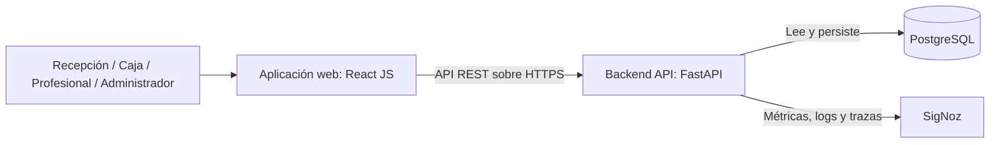
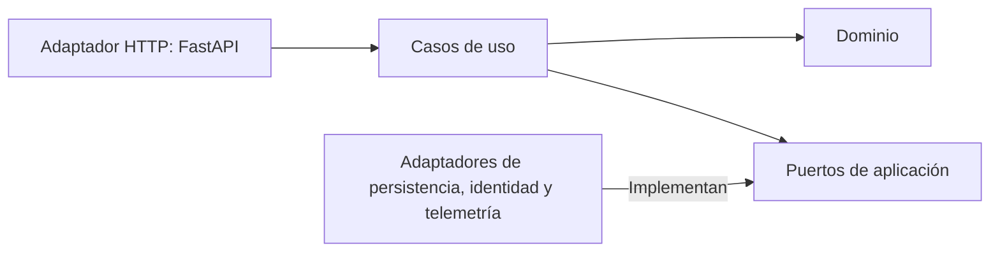

# Arquitectura vigente

Estado: primera iteración de diseño consolidada, 8 de octubre de 2026; implementación y validación pendientes. La modalidad individual o en equipo está por definir.

Este documento resume la arquitectura. La justificación, los contratos, los escenarios medibles y la evaluación de cobertura se encuentran en [ADD — Primera iteración](05_ADD_ITERACION_1.md), que es la referencia detallada vigente.

## Contexto C4

- Recepción / admisión: gestiona pacientes, citas y llegadas.
- Caja: gestiona cargos, pagos y cierres.
- Profesional de salud: consulta su agenda y gestiona atención.
- Administrador: gestiona usuarios, roles, recursos y reportes.
- Sistema: centraliza la operación administrativa de centros de salud.

## Contenedores C4

La interfaz React reemplaza a Flutter. Se elimina la CLI administrativa. Las funciones de administración del negocio se realizan desde la web mediante operaciones autorizadas de la API.

## Componentes y dependencias de código

El dominio contiene entidades, estados y reglas; no depende de frameworks ni de la base de datos. Los casos de uso coordinan reglas, autorización y persistencia mediante puertos. Los adaptadores implementan la conexión con PostgreSQL, identidad y SigNoz.

Módulos funcionales: pacientes, profesionales, servicios, consultorios, citas, admisión y flujo de atención, identidad y acceso, caja, reportes y auditoría. El backend se organiza como un monolito modular con arquitectura hexagonal, según DA-01 y DA-02 del ADD.

## Aspectos transversales

- Zero Trust: identidad y autorización por rol y registro en cada operación; mínimo privilegio.
- Nube: API sin estado local de sesión, persistencia externa, configuración por entorno, secretos fuera del código, HTTPS y comprobaciones de disponibilidad.
- Integridad: protección concurrente de reservas de pacientes, profesionales y consultorios, disponibilidad, ocupación efectiva, pagos, anulaciones y cierres; auditoría de modificaciones en la misma transacción.
- Observabilidad: métricas, logs y trazas del backend, evitando datos personales innecesarios.
- Desarrollo: OpenAI Codex, con revisión humana y evidencia de implementación.
- Verificación: Mutation testing sobre reglas del dominio y Axe-core sobre la interfaz, complementados por pruebas de concurrencia y revisión manual de accesibilidad.
- Las seis tendencias y sus relaciones están en [la matriz](03_MATRIZ_TENDENCIAS_REQUERIMIENTOS.md). Instrucciones compartidas y entorno reproducible se mantienen como prácticas de apoyo.

El PDF C4 conserva la vista preliminar anterior a esta consolidación; para los contratos y decisiones detalladas debe consultarse el ADD vigente. El PDF se reconstruyó localmente a partir del documento anterior. El proyecto remoto original de IcePanel no fue modificado.
