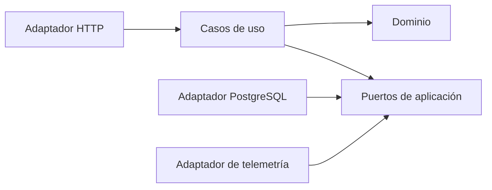

# Organización del código

Estado: estructura preparada para revisión; ninguna función implementada.

Backend en Java con Spring Boot y frontend en React, según la elección del usuario. El dominio se mantendrá independiente de Spring y JPA.

## Vista general

```text
backend/
  src/main/java/pe/centrosalud/
    modules/
      identity/             Identidad y acceso
      administration/       Pacientes y recursos del centro
      appointments/         Citas, admisión y atención
      billing/              Caja y movimientos económicos
      reporting/            Consultas e indicadores
      audit/                Auditoría del negocio
    adapters/
      inbound/http/         Entrada HTTP prevista con Spring Boot
      outbound/postgres/    Persistencia y transacciones
      outbound/telemetry/   Instrumentación técnica
    bootstrap/              Conexión de contratos y adaptadores
  src/test/java/pe/centrosalud/
    unit/
    integration/
    architecture/
frontend/
  src/
    app/                    Composición y navegación
    features/               Áreas funcionales correspondientes al backend
    shared/ui/              Componentes visuales reutilizables
    shared/api/             Cliente HTTP
    shared/lib/             Utilidades de presentación
  tests/
infra/
  deployment/
  observability/
docs/
```

## Organización dentro de cada módulo

Cada módulo contiene `domain/`, `application/usecases/` y `application/ports/`.

| Ubicación | Qué contendrá | Qué no debe contener |
|---|---|---|
| domain | Entidades, estados y reglas del módulo | Spring Boot, SQL, React, solicitudes HTTP |
| application/usecases | Coordinación de autorización, reglas, transacción y auditoría | Detalles del framework o del controlador de base de datos |
| application/ports | Contratos necesarios para ejecutar los casos de uso | Implementaciones concretas PostgreSQL o SigNoz |
| adapters/inbound/http | Rutas, esquemas de entrada y traducción de errores | Reglas de negocio duplicadas |
| adapters/outbound/postgres | Repositorios, restricciones y unidad de trabajo | Decisiones de interfaz o permisos basados en botones |
| adapters/outbound/telemetry | Exportación técnica sin información sensible | Auditoría de negocio como sustituto de su registro transaccional |
| bootstrap | Ensamblado de dependencias y configuración | Reglas o procesos del negocio |

## Dirección de dependencias



Las flechas indican dependencias del código, no el orden temporal de una solicitud. La composición conecta implementaciones a contratos. Los módulos se ejecutarán en un mismo backend y compartirán una unidad de trabajo cuando la operación requiera atomicidad; esta estructura no crea microservicios.

## Correspondencia con el ADD

| Elemento ADD | Ubicación prevista |
|---|---|
| E-01 · React | frontend/src |
| E-02 · Identidad | modules/identity |
| E-03 · Gestión administrativa | modules/administration |
| E-04 · Citas y atención | modules/appointments |
| E-05 · Caja | modules/billing |
| E-06 · Consultas y auditoría | modules/reporting y modules/audit |
| E-07 · PostgreSQL | adapters/outbound/postgres |
| E-08 · SigNoz | adapters/outbound/telemetry e infra/observability |

Reportes y auditoría se separan en carpetas porque tienen responsabilidades diferentes, aunque el ADD los agrupe en E-06. Los módulos solo deben colaborar mediante contratos explícitos; no escribirán directamente en tablas ajenas.

## Ejemplo de recorrido futuro

Una reserva entrará por HTTP, invocará un caso de uso de `appointments`, comprobará reglas del dominio y utilizará los puertos necesarios para persistencia, disponibilidad y auditoría. PostgreSQL implementará las garantías de concurrencia. Este recorrido se describe para ubicar responsabilidades: no está programado.

## Estado y límite actual

Los archivos `package-info.java` solo declaran paquetes Java y documentan su responsabilidad. No contienen clases, métodos ni anotaciones de Spring. Los `.gitkeep` permiten conservar carpetas vacías en Git. No hay clases, funciones, endpoints, modelos de tablas, componentes React, datos de demostración ni pruebas ejecutables.

Antes de comenzar la implementación, el usuario decidirá qué parte desarrollar. No se presupone autorización por la fecha de entrega.
